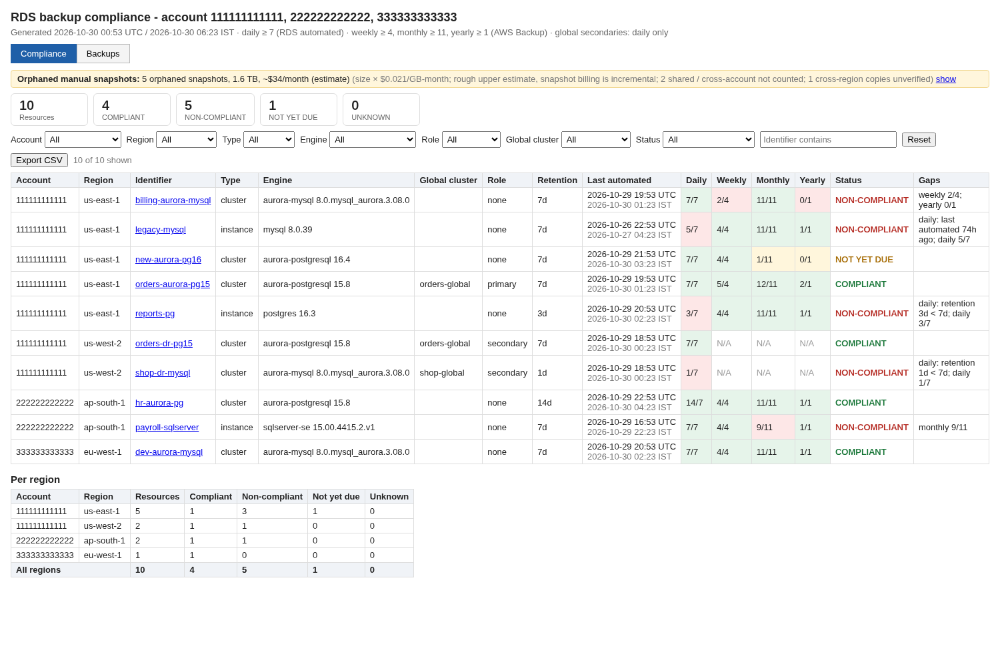

# rds-backup-compliance

`rds_backup_compliance_report.sh` (v1.7.2) checks whether your Aurora clusters and standalone RDS instances keep the backups your policy asks for, and writes a report (HTML, CSV, text or JSON). It only makes **read-only** AWS calls. It is built for AWS CloudShell, one account at a time, and the saved results can be merged offline.

**What it checks**
- **Daily:** RDS automated backups (7 days kept, one on each of the last 7 days, newest one not older than 26 hours).
- **Weekly:** an AWS Backup recovery point for every Saturday in the last 30 days.
- **Monthly:** an AWS Backup recovery point for the first Sunday of each of the last 12 months.
- **Yearly:** AWS Backup yearly points. Off by default.



Sample outputs (fake account `111111111111`) are in [samples/](https://github.com/manideepgrandhi/rds-backup-compliance/tree/main/samples/). The sample HTML report must be downloaded and opened in a browser.

## Requirements

- Bash, `jq` and AWS CLI v2 (all there in CloudShell; Git Bash with `jq.exe` also works for merging offline).
- Read-only IAM permissions: `sts:GetCallerIdentity`, `ec2:DescribeRegions`, `rds:DescribeDBClusters`, `rds:DescribeDBInstances`, `rds:DescribeGlobalClusters`, `rds:DescribeDBClusterSnapshots`, `rds:DescribeDBSnapshots`, `backup:ListBackupVaults`, `backup:ListRecoveryPointsByBackupVault`, and optionally `iam:ListAccountAliases` (account name). See [Permissions](REFERENCE.md#permissions-read-only).

## Quick start (CloudShell)

```bash
curl -fsSLO https://github.com/manideepgrandhi/rds-backup-compliance/releases/latest/download/rds-backup-compliance.zip && curl -fsSLO https://github.com/manideepgrandhi/rds-backup-compliance/releases/latest/download/rds-backup-compliance.zip.sha256
sha256sum -c rds-backup-compliance.zip.sha256 && unzip -oq rds-backup-compliance.zip && cd rds-backup-compliance   # must print "OK"
vi rds_backup_compliance_report.conf          # profile, region / all-regions, alert-email ...
./rds_backup_compliance_report.sh --check-config   # checks the settings, no AWS calls
./rds_backup_compliance_report.sh                  # HTML + CSV into ./reports
```

A quick look on the screen: `./rds_backup_compliance_report.sh -F text -o '' --non-compliant-only`. More commands with sample output: [EXAMPLES.md](EXAMPLES.md#usage-examples-v172).

## What the statuses mean

| Status | Meaning |
|---|---|
| **COMPLIANT** | Every check that applies passes. |
| **NOT YET DUE** | The server is too new to have the full set of backups, but it has one for every scheduled day since it was created. The report says when each check will be full. These servers are left out of the compliance percentage. |
| **NON-COMPLIANT** | At least one check fails. The **Gaps** column lists what is missing, for example `weekly 4/5 missing Sat 24 Oct`. |
| **UNKNOWN** | A needed AWS call was denied or failed, for example `backup:ListRecoveryPointsByBackupVault`. |

A server created on or before a scheduled day is not expected to have a backup for that day. A backup counts for a scheduled day if it was taken that UTC day, or up to 1 day before or after (weekly and monthly). Details: [Policy](REFERENCE.md#policy).

Prefer counting to dates? Set `check-mode=counts` (or run with `--check-mode counts`). A server is then compliant when it has enough backups in a window, on any weekday: 7 of the last 7 days (daily), 4 weekly points in the last 30 days and 12 monthly points in the last 12 months. A missed Saturday that you re-run on Monday brings the weekly check back to 4/4. Gaps read `weekly 3/4 in last 30d`. Details: [Check mode](REFERENCE.md#check-mode-counts-v180).

## Most-used settings

Every setting is in [rds_backup_compliance_report.conf](rds_backup_compliance_report.conf) (next to the script). Any of them can be overridden for one run with a command-line option, for example `--daily 14` or `-r us-east-1`.

| Setting | Shipped | Meaning |
|---|---|---|
| `profile` | empty | AWS CLI profile(s), one per account. Empty = the current login |
| `all-regions` / `region` | `yes` / empty | Scan every enabled region, or only `region` |
| `check-mode` | `schedule` | `schedule` = a backup on each scheduled day. `counts` = enough backups in a window, any weekday |
| `daily` / `daily-max-age` | `7` / `26` | Daily backups expected, and the newest one's maximum age in hours |
| `weekly-weekday` / `weekly-retention-days` | `sat` / `30` | Weekly backup day, and how long it is kept |
| `monthly-rule` / `monthly` / `monthly-retention-days` | `first-sun` / `12` / `365` | Monthly backup day, months checked, how long it is kept |
| `tolerance-days` | `1` | Days a backup may be early or late and still count (0-3). Not used when `check-mode=counts` |
| `format` / `output-dir` | `html,csv` / `./reports` | Report formats and where they go |
| `alert-email` | empty | Who gets an e-mail summary. Empty = no e-mail |
| `keep-reports` | `30` | Delete this tool's reports older than N days. 0 = keep all |

All 41 settings, with allowed values: [the settings file](REFERENCE.md#the-settings-file-v171) in the reference, or the **Settings reference** tab of the [simulator](https://github.com/manideepgrandhi/rds-backup-compliance/blob/main/docs/rds_compliance_simulator.html).

## Exit codes

| Code | Meaning |
|---|---|
| 0 | OK |
| 1 | Usage or settings error |
| 2 | Pre-check failed (aws, jq, credentials or region) |
| 3 | Bad merge input |
| 4 | Output error |
| 5 | NON-COMPLIANT found, with `--fail-on-noncompliant` |
| 130 | Interrupted |

## More docs

- [REFERENCE.md](REFERENCE.md): the full reference. Policy, role rules, outputs, orphaned snapshots, several accounts, parallel scanning, the settings file, `keep-reports`, e-mail, exceptions, permissions, limitations, tests and technical version notes.
- [EXAMPLES.md](EXAMPLES.md): usage examples with sample output.
- [CHANGELOG.md](CHANGELOG.md): what changed in each release. Also on the [What's new](https://manideepgrandhi.github.io/rds-backup-compliance/) page.
- [compliance_exceptions.conf.example](compliance_exceptions.conf.example): template for marking approved exceptions (see [Compliance exceptions](REFERENCE.md#compliance-exceptions-v160)).
- In [docs/](https://github.com/manideepgrandhi/rds-backup-compliance/tree/main/docs/):
  - [rds_compliance_simulator.html](https://github.com/manideepgrandhi/rds-backup-compliance/blob/main/docs/rds_compliance_simulator.html): enter a creation date and backups and see how a server is marked. It also has a **Settings reference** tab and a **Run examples** tab.
  - [rds_code_walkthrough.html](https://github.com/manideepgrandhi/rds-backup-compliance/blob/main/docs/rds_code_walkthrough.html): step-by-step walk through the code that runs and the files it uses.
  - [RDS_Backup_Compliance_Walkthrough.pptx](https://github.com/manideepgrandhi/rds-backup-compliance/blob/main/docs/RDS_Backup_Compliance_Walkthrough.pptx): team deck.

The two HTML pages are not hosted. GitHub shows their source, so download them and open them in a browser. They work offline.
